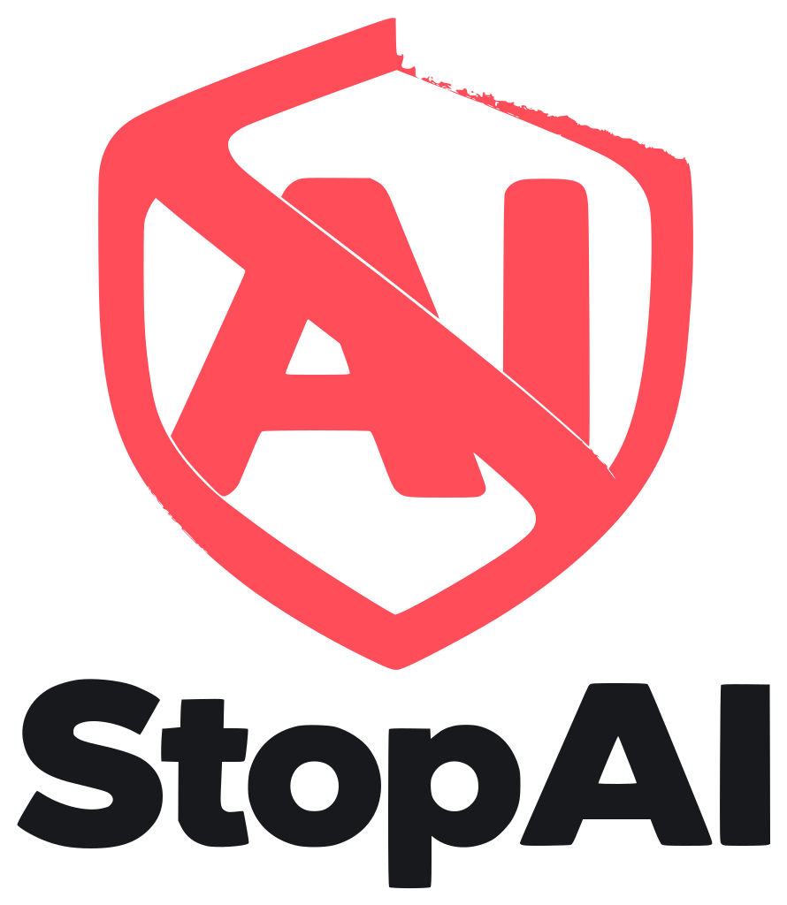

<p align="center">
  <picture>
    <source media="(prefers-color-scheme: dark)" srcset="assets/logo/stopai-logo-dark.svg">
    
  </picture>
</p>

# Stop AI

[Español](#español) · [English](#english)

---

## Español

Extensión para navegadores basados en Chromium (Chrome, Edge, Brave, Opera, Vivaldi) que bloquea el contenido generado por IA en YouTube (incluye Shorts), TikTok, Facebook, Instagram, ReelShort y X.

La interfaz está en español e inglés; el idioma se cambia desde el popup (por defecto sigue el idioma del navegador).

### Cómo detecta

| Método | Descripción |
|---|---|
| Etiquetas oficiales | "Contenido alterado o sintético", "AI-generated", "Info de IA", "Made with AI", etc. |
| Hashtags | #ai, #aiart, #sora, #midjourney, #veo3, #klingai, #iagenerativa, etc. |
| Palabras clave | Lista propia editable desde el popup |
| Cuentas | Lista negra de canales y usuarios editable desde el popup |

El contenido de IA sin etiqueta ni esas señales no se detecta.

### Modos

- **Difuminar**: tapa el contenido con un aviso y un botón "Mostrar".
- **Ocultar**: lo elimina del feed. En feeds de video a pantalla completa (TikTok, Shorts, Reels) se difumina siempre.

Los videos bloqueados se pausan y no se reproducen solos.

### Instalación (modo desarrollador)

1. Descarga o clona este repositorio.
2. Abre `chrome://extensions`, `edge://extensions` o `brave://extensions`.
3. Activa **Modo de desarrollador**.
4. Pulsa **Cargar descomprimida** y elige la carpeta del repositorio.

### Estructura

```
manifest.json        Manifest V3
_locales/            Nombre y descripción de la extensión (es/en)
src/rules.js         Etiquetas, hashtags, selectores por plataforma y configuración por defecto
src/i18n.js          Textos de la interfaz (es/en)
src/content.js       Motor de detección y bloqueo
src/content.css      Estilos del bloqueo
popup/               Interfaz de configuración
icons/               Íconos de la extensión (PNG)
assets/logo/         Logos (SVG) y originales
```

Para añadir una plataforma o actualizar selectores, edita `PLATFORMS` en `src/rules.js` y añade el dominio a `matches` en `manifest.json`. Para añadir un idioma, añade sus textos en `src/i18n.js` y `_locales/`.

### Donaciones

[](https://www.paypal.com/donate/?hosted_button_id=Z78W8SWDG6V5S)

---

## English

Extension for Chromium-based browsers (Chrome, Edge, Brave, Opera, Vivaldi) that blocks AI-generated content on YouTube (including Shorts), TikTok, Facebook, Instagram, ReelShort and X.

The interface is available in Spanish and English; switch the language from the popup (defaults to the browser language).

### How it detects

| Method | Description |
|---|---|
| Official labels | "Altered or synthetic content", "AI-generated", "AI info", "Made with AI", etc. |
| Hashtags | #ai, #aiart, #sora, #midjourney, #veo3, #klingai, etc. |
| Keywords | Your own list, editable from the popup |
| Accounts | Blocklist of channels and users, editable from the popup |

AI content without labels or these signals is not detected.

### Modes

- **Blur**: covers the content with a notice and a "Show" button.
- **Hide**: removes it from the feed. Full-screen video feeds (TikTok, Shorts, Reels) are always blurred.

Blocked videos are paused and do not autoplay.

### Installation (developer mode)

1. Download or clone this repository.
2. Open `chrome://extensions`, `edge://extensions` or `brave://extensions`.
3. Turn on **Developer mode**.
4. Click **Load unpacked** and select the repository folder.

### Donations

[](https://www.paypal.com/donate/?hosted_button_id=Z78W8SWDG6V5S)

---

## Licencia / License

MIT
